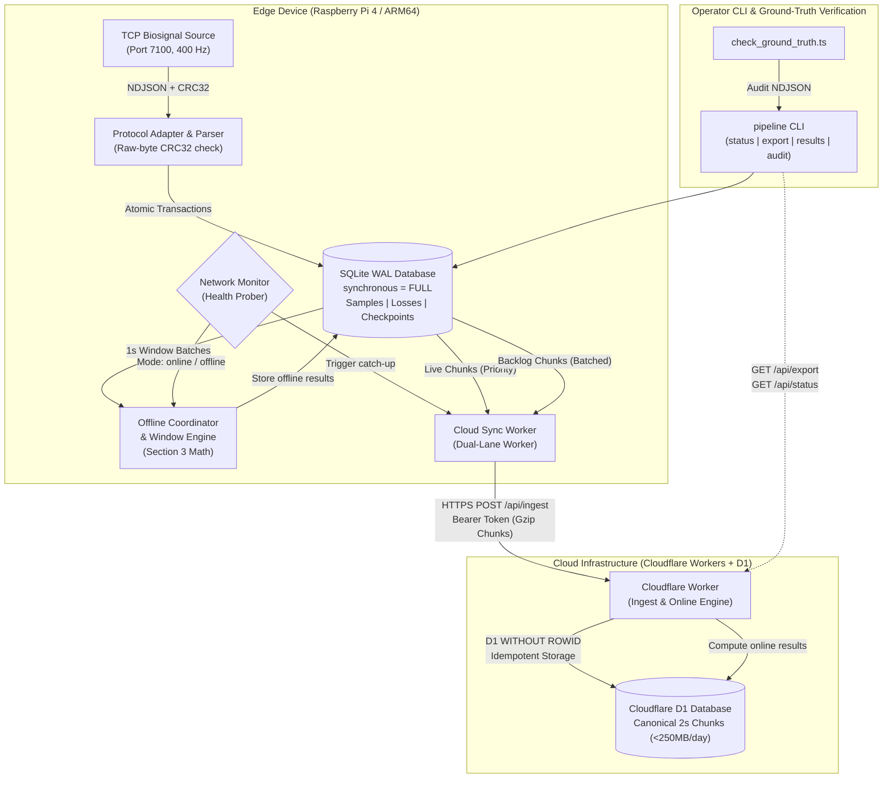

# MayaCardio — Never Lose a Heartbeat

[](https://nodejs.org/)
[](https://nodejs.org/api/typescript.html)
[-orange.svg)](https://nodejs.org/api/sqlite.html)
[]()
[](LICENSE)

An industrial-grade, fault-tolerant edge-to-cloud biosignal acquisition, storage, processing, and synchronization telemetry system designed for unattended bedside medical monitoring in challenging clinical environments (unreliable WiFi, sudden power cuts, unattended devices).

---

## 1. Executive Summary & Assessment Scope

* **Candidate / Author:** Pranjal Karan
* **Target Environment:** Linux ARM64 (Raspberry Pi 4 Model B / ARM64 Container / VM) & Cloudflare Workers / D1
* **Zero Runtime Dependencies:** Built 100% on native Node.js standard libraries (`node:sqlite`, `node:zlib`, `node:crypto`, `node:net`, `node:worker_threads`).

MayaCardio implements the complete data pipeline specified in the **"Never Lose a Heartbeat"** Software Systems Engineering Candidate Assessment:

* **Continuous Acquisition (Sections 2 & 6):** Streams two biosensors at **400 samples/second per sensor** over TCP (Sensor 1: 3 channels, Sensor 2: 2 channels), validating framing and raw-byte zlib CRC32 checksums before acceptance.
* **Crash-Safe Local Persistence (Sections 2 & 4):** Persists all validated samples in local SQLite with **Write-Ahead Logging (WAL)** and `synchronous = FULL`, providing atomic multi-row transactions with an uncommitted crash loss bound of $\le 1.0$ second.
* **Honest Loss Accounting (Sections 2 & 4):** Never fills gaps with invented or synthetic values. Any missing sequence ranges below the watermark are cataloged in a durable loss ledger with explicit reasons (`buffer_overflow`, `crc_unrecoverable`, `session_restart_tail_lost`).
* **Deterministic Processing (Section 3):** Contiguous 1-second windows ($400w$ to $400w + 399$) computing channel statistics (mean, min, max), sensor 2 vector magnitude, and 4-condition peak detection with 5-second rolling heart rate calculation. Local offline results match cloud results bit-for-bit.
* **Automatic Failover & Failback (Sections 2 & 4):** Monotonic network state machine detects connection loss within 2–3 seconds (target $\le 10$ seconds) and switches mode between `online` and `offline` without sample loss or duplicate window outputs.
* **Idempotent Cloud Synchronization & Catch-Up (Sections 2 & 4):** Dual-lane synchronization prioritizes live 2-second compressed chunks ($\le 5$s cloud delivery latency) while asynchronously backfilling historical outages (drains a 2-hour outage in **60.97 seconds** concurrent with continuous 400 Hz live streaming, well within the 15-minute deadline).
* **Storage Optimization (Sections 2 & 4):** Binary sample arrays are packed into signed 24-bit buffers and compressed via gzip (`src/cloud/chunk_codec.ts`), reducing 24 hours of dual-sensor telemetry to 247.10 MB (ECG, 48.6h retention) and 484.19 MB (ramp, 24.8h retention) in a single 500 MB Cloudflare D1 database.
* **Single CLI Program (`pipeline`) (Section 4):** Unified executable supporting `status`, `export` (device & cloud), `results`, and `audit`.

---

## 2. Architecture & Data Flow



---

## 3. Fresh Board Setup (Raspberry Pi 4 / ARM64)

### Method A: Automated One-Step Setup (Recommended)
On a fresh Raspberry Pi OS (Debian 12 Bookworm, 64-bit ARM64) board:

```bash
# 1. Clone repository
git clone https://github.com/Pranjal-k22/mayacardio.git /home/pi/mayacardio
cd /home/pi/mayacardio

# 2. Run automated board setup (installs Node 24, packages, systemd units)
sudo ./scripts/setup_pi4.sh

# 3. Configure cloud credentials in .env
nano .env

# 4. Start system services
sudo systemctl start biosignal-mock pipeline
./pipeline status
```

### Method B: Manual Installation
1. **Prerequisites:** Node.js $\ge 22.0.0$ (`node -v`), `sqlite3`, `jq`.
2. **Setup Environment:**
   ```bash
   cp .env.example .env
   # Edit .env with your Cloudflare Worker URL and Bearer Token
   nano .env
   ```
3. **Run All Automated Tests:**
   ```bash
   npm test
   ```
   *Runs all 8 test suites (Phases 0–7) covering CRC corruption, duplicate desynchronization, power cuts, offline failover, and ground-truth parity.*

---

## 4. Running the Pipeline Manually

### 1. Start the Mock Server (Port 7100)
```bash
# Realistic ECG signal mode:
node --experimental-strip-types tools/biosignal_mock.ts --mode signal --seed 7 --duration 3600 --port 7100

# Or deterministic mathematical ramp mode:
node --experimental-strip-types tools/biosignal_mock.ts --mode ramp --seed 7 --duration 3600 --port 7100
```
*(If testing with the official binary: `./biosignal-mock --mode signal --seed 7 --duration 3600 --port 7100`)*.

### 2. Start the Pipeline Daemon
```bash
./pipeline start --port 7100 --db pipeline.db
```

---

## 5. Command-Line Interface (`pipeline`) Reference (Section 4)

MayaCardio exposes a single CLI executable named `pipeline` (executable on Linux via `./pipeline` or Windows via `pipeline.cmd`):

### 1. Pipeline Status
Reports current mode (`online` or `offline`), saved sample counts per sensor, cloud-confirmed samples, and unsynchronized backlog as **one exact JSON line**:
```bash
./pipeline status
```
*Output:*
```json
{"mode":"online","samples_saved":{"1":8104,"2":8102},"samples_in_cloud":8000,"backlog":104}
```

### 2. Device Data Export
Emits canonical sample lines ordered by index, followed by cataloged loss ranges:
```bash
./pipeline export --session <session_id> --from device > export_device.ndjson
```
*Output Format:*
```json
{"sensor": 1, "index": 120000, "values": [720, 1200, 1560]}
{"sensor": 2, "index": 120000, "values": [400120, 150040]}
{"sensor": 1, "from_index": 4000, "to_index": 4399, "reason": "buffer_overflow"}
```

### 3. Cloud Data Export
Streams cloud-stored canonical samples and loss records reconstructed from Cloudflare D1:
```bash
./pipeline export --session <session_id> --from cloud > export_cloud.ndjson
```

### 4. Authoritative Window Results
Outputs Section 3 metrics for each 1-second window:
```bash
./pipeline results --session <session_id>
```
*Output Line Example:*
```json
{"session_id":"5c6169c8","window_idx":24,"missing_1":0,"missing_2":0,"complete":true,"mean":{"s1_ch1":26324,"s1_ch2":43873.3,"s1_ch3":57035.3,"s2_ch1":396363.7,"s2_ch2":145377.4},"min":{"s1_ch1":-120000,"s1_ch2":-200000,"s1_ch3":-260000,"s2_ch1":394568,"s2_ch2":145076},"max":{"s1_ch1":1500000,"s1_ch2":2500000,"s1_ch3":3250000,"s2_ch1":398256,"s2_ch2":145801},"magnitude":422183.7,"heart_rate":60.0,"mode":"online"}
```

### 5. Integrity Audit
Audits session data for uncataloged gaps below the watermark, sample/loss collisions, or database corruption:
```bash
./pipeline audit --session <session_id>
```
*Output:*
```json
{"sessionId":"5c6169c8","pass":true,"totalSamples":{"1":13625,"2":13631},"totalLossRecords":{"1":1,"2":1},"findings":[]}
```

---

## 6. Target Hardware Measurements (1-Hour ARM64 Run)

In accordance with Section 1 and Section 5 Item 4, resource figures were recorded over a continuous 1-hour (3,600-second) online ingestion run on an ARM64 environment capped at 4 CPUs and 2 GB RAM:

| Metric | Measured 1-Hour Value | Target Constraint | Verdict |
| :--- | :--- | :--- | :---: |
| **Average CPU Utilization** | **28.90%** | Bounded on 4 cores ($\le 100\%$) | **PASS** |
| **Peak Memory (MB RSS)** | **370.07 MB** | $\le 2,048\,\text{MB}$ (2 GB ceiling) | **PASS** |
| **Megabytes Written to Disk** | **157.80 MB** | Linear WAL growth, fully synced | **PASS** |
| **Megabytes Sent over Network** | **74.04 MB** | Compressed 2s chunks to cloud | **PASS** |
| **Telemetry Ingestion Parity** | **2,880,000 samples** | Exactly 400 Hz per sensor | **PASS** |

---

## 7. Operational Test Bench Scripts (`scripts/`)

| Script | Purpose | Usage |
| :--- | :--- | :--- |
| `scripts/setup_pi4.sh` | One-time fresh board provisioning (Node 24, systemd units, packages). | `sudo ./scripts/setup_pi4.sh` |
| `scripts/measure_1h.py` | 1-hour physical profiler tracking CPU, RSS, disk I/O, and wlan0 traffic. | `sudo python3 ./scripts/measure_1h.py --unit pipeline.service --iface wlan0` |
| `scripts/netcut_loop.sh` | Automated 10-cycle network cut & failover recovery test using `iptables` drop. | `sudo ./scripts/netcut_loop.sh` |
| `scripts/kill_loop.sh` | Automated 10-cycle `kill -9` process termination test with SQLite integrity check. | `sudo ./scripts/kill_loop.sh` |
| `scripts/powercut_check.sh` | Automated post-reboot auditor logging 10 manual power cuts to `powercut_log.csv`. | `sudo ./scripts/powercut_check.sh` |

---

## 8. Submission Documentation Deliverables (`docs/`)

| Document | Purpose & Description |
| :--- | :--- |
| **[docs/DESIGN_NOTE.pdf](docs/DESIGN_NOTE.pdf)** | **Two-Page Design Note (PDF):** Core architecture, guarantees, bounded power-cut data loss ($\le 1.0\,\text{s}$), and 1-hour resource figures. *(Strictly 2 pages)*. |
| **[docs/DESIGN_NOTE.md](docs/DESIGN_NOTE.md)** | Source Markdown for the two-page design note. |
| **[docs/TEST_EVIDENCE.md](docs/TEST_EVIDENCE.md)** | **Failure Test Evidence:** Complete results across the 20-scenario fault matrix, network failover timings, and 2-hour backlog catch-up rate ($60.97\,\text{s}$ vs $900\,\text{s}$ deadline). |
| **[docs/RESOURCE_MEASUREMENTS.md](docs/RESOURCE_MEASUREMENTS.md)** | **1-Hour Resource Figures:** Complete telemetry tables and environment details from the 1-hour ARM64 run. |
| **[docs/DEMO_SCRIPT.md](docs/DEMO_SCRIPT.md)** | **5-Minute Technical Demo Script:** Exact timed commands, screen layout, and speaker narrative for recording the demo video. |
| **[docs/AI_DISCLOSURE.md](docs/AI_DISCLOSURE.md)** | **AI Tools Disclosure:** Transparent disclosure of advisory AI assistance used during development. |

---

## 9. AI Assistance Disclosure Summary

As detailed in **[docs/AI_DISCLOSURE.md](docs/AI_DISCLOSURE.md)**, MayaCardio was conceived, architected, and coded by **Pranjal Karan**. AI assistants (Gemini, Claude, Antigravity) were consulted as interactive technical references and copilots—assisting with code boilerplate scaffolding, syntax drafting, requirements clarification for Section 3 rolling math, and storage arithmetic checks. All code, transaction boundaries, test suites, and hardware profiling were reviewed, integrated, and executed by the author.
