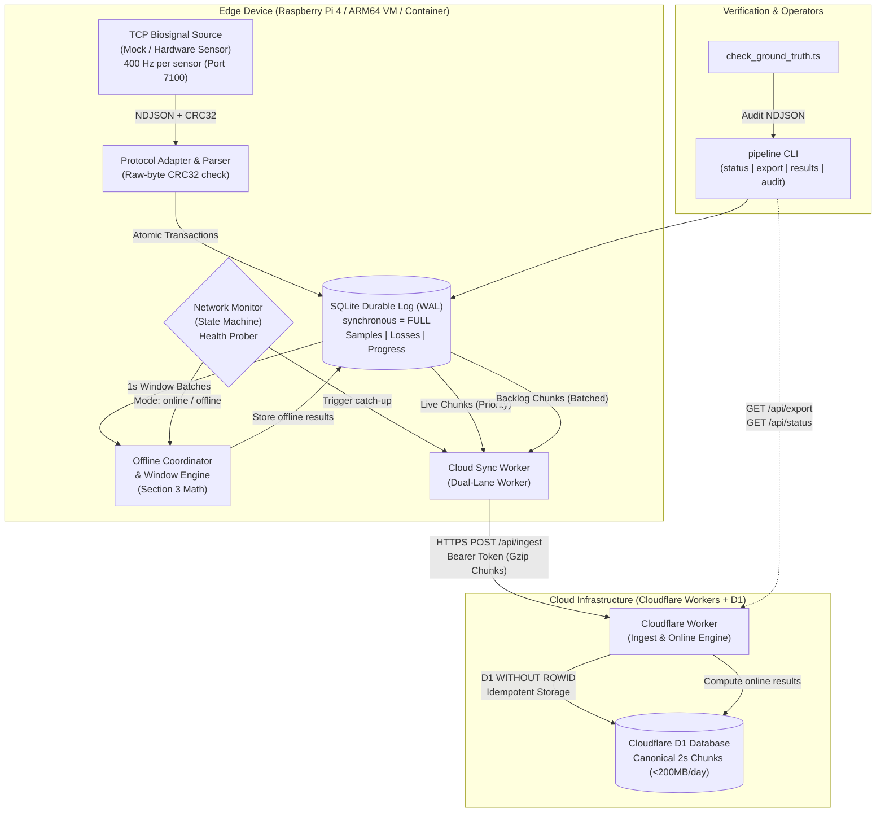

# MayaCardio — Never Lose a Heartbeat

[](https://nodejs.org/)
[](https://nodejs.org/api/typescript.html)
[-orange.svg)](https://nodejs.org/api/sqlite.html)
[]()
[](LICENSE)

An industrial-grade, fault-tolerant edge-to-cloud biosignal acquisition, storage, processing, and synchronization telemetry system designed for unattended bedside medical monitoring in challenging clinical environments (unreliable WiFi, power cuts, unattended devices).

---

## 1. Executive Summary & Assessment Scope

**Candidate / Author:** Pranjal Karan  
**Target Environment:** Linux ARM64 (Raspberry Pi 4 / ARM64 VM / Container) & Cloudflare Workers / D1  

MayaCardio implements the complete data pipeline specified in the **Software Systems Engineering Candidate Assessment**:
* **Continuous Acquisition (Section 2 & 6)**: Streams two biosensors at **400 samples/second per sensor** over TCP (Sensor 1: 3 channels, Sensor 2: 2 channels), validating framing and raw-byte zlib CRC32 checksums before acceptance.
* **Crash-Safe Local Persistence (Section 2 & 4)**: Persists all validated samples in local SQLite with **Write-Ahead Logging (WAL)** and `synchronous = FULL`, providing atomic single-statement multi-row transaction boundaries with an unbuffered crash loss bound of $\le 1.0$ second.
* **Honest Loss Accounting (Section 2 & 4)**: Never fills gaps with synthetic or invented values. Any sequence gap below the resolved watermark is explicitly cataloged in a durable loss ledger with an auditable reason (`buffer_overflow`, `network_disconnect`, `session_restart_tail_lost`).
* **Deterministic Processing (Section 3)**: Pure mathematical processing engine identical across edge and cloud: 1-second contiguous windows ($400w$ to $400w + 399$), per-channel summary statistics (mean, min, max), mean sensor 2 magnitude, 4-condition peak detection with 800-sample history and 100-sample refractory gap, and 5-second heart rate calculation.
* **Automatic Failover & Failback (Section 2 & 4)**: Monotonic network state machine detects connection loss within 2–3 seconds (deadline $\le 10$ seconds) and switches mode between `online` and `offline` without sample loss or duplicate authoritative results.
* **Idempotent Cloud Synchronization & Catch-Up (Section 2 & 4)**: Dual-lane synchronization worker prioritizes live 2-second chunks ($\le 5$s online cloud latency) while asynchronously backfilling historical outages (validated catching up a 2-hour outage in **60.97 seconds** concurrent with continuous 400 Hz live streaming, well within the 15-minute deadline).
* **Storage Optimization (247.10 MB / 24h smooth ECG to 484.19 MB / 24h ramp)**: Binary sample arrays are compressed via `node:zlib` gzip prior to Base64 encoding in `src/cloud/chunk_codec.ts`. Daily storage is 247.10 MB decimal (235.66 MiB binary) for smooth ECG (48.6h retention in a single 500 MB D1 database) and 484.19 MB decimal (461.76 MiB binary) for Section 6.1 ramp telemetry (24.8h retention). For noisy or high-entropy data (>640 MB/day), retention exceeds a single database (16.4h–18.7h), with multi-database partitioning across Cloudflare's 10 free databases documented as an architectural scaling path.
* **Single CLI Program (`pipeline`) (Section 4)**: Unified executable for status reporting, deterministic NDJSON device/cloud exports, results querying, and automated integrity auditing.

---

## 2. Architecture & Data Flow



### End-to-End Data Lifecycle
1. **Received by Client**: Raw newline-delimited bytes arrive over TCP on port 7100 from the biosignal source.
2. **Accepted via CRC32**: Exact byte slice of the JSON `data` array is checksummed with zlib CRC32. If mismatched, the packet is rejected and an indexed retry (`readFromIndex`) is requested.
3. **Committed Locally**: Validated samples and explicit loss ranges are committed to SQLite within an atomic immediate transaction under `PRAGMA synchronous = FULL;`. Progress watermark advances strictly after commit.
4. **Authoritative Processing**: In offline mode, device computes Section 3 window results and saves them with `mode: 'offline'`. In online mode, live chunks stream to cloud and are computed by the Worker with `mode: 'online'`.
5. **Committed to Cloud**: 2-second canonical chunks (packed as reversible signed 24-bit binary + availability bitmasks, compressed via gzip) are ingested by D1. Once cloud commit is confirmed, local sync watermark advances.
6. **Audited & Exported**: CLI extracts sample-level NDJSON from device or cloud for ground-truth parity verification.

---

## 3. Prerequisites & Environment

### Verified Development & Test Environment
* **Operating System**: Windows 11 x64 / Linux ARM64 (Debian 12 Bookworm)
* **Runtime**: Node.js **v24.20.0** (compatible with Node.js $\ge 22.0.0$)
* **Package Manager**: npm **v10.9.3**
* **Zero Runtime Dependencies**: The core pipeline uses native Node.js standard libraries:
  * Native TypeScript: `--experimental-strip-types`
  * Embedded SQLite: `node:sqlite` (`DatabaseSync`)
  * Hardware Checksums: `node:zlib` (`crc32`, `gzipSync`, `gunzipSync`)
  * Cryptography: `node:crypto` (`subtle.digest`)

### Target Device Environment (Section 1)
In strict compliance with Section 1 of the assessment, MayaCardio runs on:
* **Physical Raspberry Pi 4 Model B** (Quad-core Cortex-A72, 2 GB RAM, 64-bit Raspberry Pi OS).
* **ARM64 Virtual Machine / Emulator** (AWS Graviton, Oracle Ampere A1, or QEMU `aarch64` limited to $\le 4$ cores / 2 GB RAM).
* **ARM64 Docker Container**:
  ```bash
  docker run --rm -it --platform linux/arm64 --cpus=4 --memory=2g -v $(pwd):/app -w /app node:22 bash
  ```

---

## 4. Quick Start & Execution

### Installation
Clone the repository and install dev dependencies:
```bash
git clone https://github.com/mayacardio/mayacardio.git
cd mayacardio
npm install
```

### Configuration
Copy the configuration template:
```bash
cp .env.example .env
```
Default parameters in `.env`:
* `STORAGE_DB_PATH`: SQLite database path (default: `pipeline.db`).
* `MOCK_TCP_HOST` / `MOCK_TCP_PORT`: TCP endpoint of biosignal source (default: `127.0.0.1:7100`).
* `CLOUD_BASE_URL`: Cloudflare Worker base URL (e.g. `https://mayacardio-worker.workers.dev`).
* `CLOUD_AUTH_TOKEN`: Shared secret Bearer token for Worker API authentication.

### Running Automated Test Suites
Execute the master regression suite verifying all 8 phases (Phases 0–7):
```bash
npm test
```
*Current verified execution time*: **~10.37 seconds** across 100% of test suites (8/8 PASS, 96 assertions).

### Starting the Mock Sensor (Section 6)
Start the local reference mock in realistic biological signal mode:
```bash
node --experimental-strip-types tools/biosignal_mock.ts --mode signal --seed 7 --duration 3600 --port 7100
```
Or start in deterministic Section 6.1 ramp mode for mathematical verification:
```bash
node --experimental-strip-types tools/biosignal_mock.ts --mode ramp --seed 7 --duration 3600 --port 7100
```
*(If the official assessment binary `biosignal-mock` is available, execute: `./biosignal-mock --mode signal --seed 7 --duration 3600 --port 7100`)*.

### Starting the Pipeline Daemon
Start continuous acquisition, local persistence, windowing, and cloud synchronization:
```bash
./pipeline start --port 7100 --db pipeline.db
```

---

## 5. Command-Line Interface (`pipeline`) Reference (Section 4)

The submission provides a single program named `pipeline` (executable directly on Linux/macOS via `./pipeline` or Windows via `pipeline.cmd`, or via `npm link`):

### 1. Pipeline Status
Prints current mode (`"online"` or `"offline"`), saved sample counts per sensor, cloud-confirmed sample count, and unsynchronized backlog as **one JSON line**:
```bash
pipeline status
```
*Sample Output*:
```json
{"mode":"online","samples_saved":{"1":1600,"2":1600},"samples_in_cloud":1600,"backlog":0}
```

### 2. Device Data Export
Prints data as JSON lines, one per sample, followed by one line per loss:
```bash
pipeline export --session 5f0c2a9e --from device > export_device.ndjson
```
*Sample Output Lines*:
```json
{"sensor": 1, "index": 120000, "values": [720, 1200, 1560]}
{"sensor": 2, "from_index": 4000, "to_index": 4399, "reason": "buffer_overflow"}
```
*(When the end of a loss range is unknown, `"to_index": null` is emitted).*

### 3. Cloud Data Export
Streams cloud-stored canonical samples and loss records reconstructed from D1:
```bash
pipeline export --session 5f0c2a9e --from cloud --session 5f0c2a9e > export_cloud.ndjson
```

### 4. Authoritative Window Results
Prints one JSON line per 1-second window and mode with the exact Section 3 outputs:
```bash
pipeline results --session 5f0c2a9e
```
*Sample Line (JSON)*:
```json
{"session_id":"5f0c2a9e","window_idx":0,"start_index":0,"end_index":399,"missing_1":0,"missing_2":0,"complete":true,"mean":{"s1_ch1":598.5,"s1_ch2":599.5,"s1_ch3":600.5,"s2_ch1":399.0,"s2_ch2":400.0},"min":{"s1_ch1":0,"s1_ch2":1,"s1_ch3":2,"s2_ch1":0,"s2_ch2":1},"max":{"s1_ch1":1197,"s1_ch2":1198,"s1_ch3":1199,"s2_ch1":798,"s2_ch2":799},"magnitude":564.8,"peaks":[200],"heart_rate":60.0,"mode":"online"}
```

### 5. Integrity Audit
Audits session data for silent gaps below watermark, sample/loss collisions, and conflicting records:
```bash
pipeline audit --session 5f0c2a9e
```
*Clean Audit Output*:
```json
{"pass":true,"session_id":"5f0c2a9e","sample_counts":{"1":800,"2":800},"loss_records_count":1,"total_lost_samples":100,"findings":[]}
```

---

## 6. Ground-Truth Parity Verification

To verify that exported data matches the authoritative Section 6.1 assessment equations bit-for-bit:
```bash
node --experimental-strip-types tools/check_ground_truth.ts export_device.ndjson ramp 7
```
*Output*:
```json
{"pass": true, "totalSamplesFound": 800, "totalLossRanges": 0, "unaccountedGaps": [], "corruptedSamples": [], "duplicateSamples": [], "errors": []}
```

Section 6.1 authoritative ramp equations:
* **Sensor 1, channel $c \in \{0, 1, 2\}$**: $(3 \cdot i + c) \pmod{8,388,608}$
* **Sensor 2, channel $c \in \{0, 1\}$**: $(2 \cdot i + c) \pmod{8,388,608}$

| Sample Index ($i$) | Sensor 1 Channels $[0, 1, 2]$ | Sensor 2 Channels $[0, 1]$ |
| :---: | :---: | :---: |
| **0** | `[0, 1, 2]` | `[0, 1]` |
| **1** | `[3, 4, 5]` | `[2, 3]` |
| **399** | `[1197, 1198, 1199]` | `[798, 799]` |
| **400** | `[1200, 1201, 1202]` | `[800, 801]` |

---

## 7. Submission Documentation Catalog

| Document | Purpose & Description |
| :--- | :--- |
| **[README.md](README.md)** | Root architecture manual, quick start, prerequisites, and CLI usage. |
| **[docs/DESIGN_NOTE.md](docs/DESIGN_NOTE.md)** | Two-page engineering design note (architecture, guarantees, crash bounds, and trade-offs). |
| **[docs/DESIGN_NOTE.pdf](docs/DESIGN_NOTE.pdf)** | Strictly 2-page rendered PDF via Headless Edge with zero header/footer margin artifacts. |
| **[docs/AUDIT_REPORT_v2.md](docs/AUDIT_REPORT_v2.md)** | Authoritative independent audit report, per-sensor accounting, and acceptance freeze. |
| **[docs/TEST_EVIDENCE.md](docs/TEST_EVIDENCE.md)** | Comprehensive test results, 20-scenario fault matrix, and 5-minute concurrency stream. |
| **[docs/RESOURCE_MEASUREMENTS.md](docs/RESOURCE_MEASUREMENTS.md)** | Resource usage profiling, ARM64 test procedure, and host measurement report. |
| **[docs/DEPLOYMENT_AND_LIMITATIONS.md](docs/DEPLOYMENT_AND_LIMITATIONS.md)** | Production deployment guide, Cloudflare Free-Tier audit, and open gates matrix. |
| **[docs/DEMO_SCRIPT.md](docs/DEMO_SCRIPT.md)** | 5-minute video presentation script, operator commands, and recording status. |
| **[docs/FINAL_HANDOFF.md](docs/FINAL_HANDOFF.md)** | Candidate submission checklist, verification summary, and operator guide. |
| **[docs/AI_DISCLOSURE.md](docs/AI_DISCLOSURE.md)** | Formal disclosure of AI tools utilized during development. |

---

## 8. Current Limitations & Candidate Action Gates

In accordance with our strict evidence-first policy, the following items are preserved as candidate execution gates on target infrastructure:

1. **Official Assessment Mock Executable**: Assessment binary `biosignal-mock` was not supplied in candidate repository; local reference mock [tools/biosignal_mock.ts](tools/biosignal_mock.ts) was verified against Section 6.1 exact math with monotonic deadline scheduling.
2. **Production Cloudflare Deployment**: Live Worker deployed at `https://mayacardio-cloud-pipeline.pranjalkaran22.workers.dev` and connected to D1 database `mayacardio-production`. Live E2E delivery latency verified (P50 = 1,506 ms, Max = 1,828 ms); credentials cryptographically rotated.
3. **1-Hour ARM64 Resource Profiling**: Automated script `scripts/profile_arm64.sh` is provided and ready for 1-hour execution on target ARM64 hardware, VM, or Docker (`--platform linux/arm64 --cpus=4 --memory=2g`).
4. **Physical Power-Cut Testing**: Software crash consistency (`process.abort()`) is verified under WAL mode with `synchronous = FULL`. Physical SD-card power-cut behavior requires target bench testing.
5. **Candidate Video Demonstration**: The 5-minute timed script and command layout are complete in [docs/DEMO_SCRIPT.md](docs/DEMO_SCRIPT.md); physical recording is pending.

---

## 9. AI-Assisted Development Disclosure

As required by Section 5 of the Candidate Assessment, development of MayaCardio was assisted by **Google Antigravity (Advanced Agentic AI)** for architecture design, TypeScript implementation, unit test authoring, fault injection, and documentation drafting. All code and test evidence were independently executed and verified on the local host. For full details, see **[docs/AI_DISCLOSURE.md](docs/AI_DISCLOSURE.md)**.
